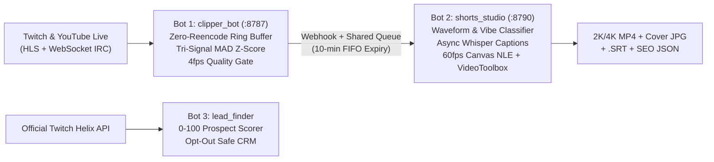

# StreamCut Studio — Multi-Bot 24/7 Live Stream Clipper & Automated Shorts Studio

An end-to-end, local-first multi-bot media pipeline (~9,000 LOC in Python & vanilla JavaScript) that monitors live Twitch and YouTube streams 24/7, detects genuine viral reactions using a tri-signal anomaly detector, and automatically turns them into broadcast-grade `1440×2560` (2K) / `2160×3840` (4K) YouTube Shorts with dynamic `Cam Top + Mid Gameplay` reframing, local OpenAI Whisper word-level captions, and synthesized copyright-free music & SFX.

---

## Architecture Overview



### Key Subsystems
- **[`clipper_bot/`](clipper_bot/) (Bot 1 — 24/7 Stream Watcher & Viral Detector)**: Records rolling `18×10s` MPEG-TS ring buffers (`ffmpeg -c copy`, `<1%` CPU/stream), filters Twitch bots/copypasta/raids with a robust Median/MAD Z-score, fuses chat + 8 kHz PCM audio + visual scene-cut intensity, enforces a 4fps frozen/black/silent quality gate, and syncs clips in real time.
- **[`shorts_studio/`](shorts_studio/) (Bot 2 — CUTLAB PRO Shorts Studio)**: Unified browser NLE (`http://127.0.0.1:8790/`) with embedded Bot 1 fallback, `<50 ms` instant clip preview, 5-mood vibe classifier, procedural NumPy WAV BGM + SFX synthesizers, async local OpenAI Whisper word-level karaoke captions, Lanczos + `hqdn3d` + AMD FidelityFX `cas` vertical reframing, `-14 LUFS` EBU R128 broadcast audio chain, and Apple Silicon `h264_videotoolbox` (with cross-platform `libx264` fallback).
- **[`lead_finder/`](lead_finder/) (Bot 3 — Streamer Prospecting CLI)**: Official Twitch Helix API prospect discovery and `0–100` scoring for done-for-you clipping services, honoring bio opt-outs and `do_not_contact.txt`.

---

## Technical Report

- **[Clipper Technical & Architecture Report](docs/CLIPPER_REPORT.md)** — Complete engineering breakdown of how the bots work together, inter-bot sequence diagrams, 5-layer categorization & scoring taxonomy, media/DSP pipeline details, and engineering challenges solved with benchmarks.

---

## Quick Start (Run Locally in 2 Commands)

### Prerequisites
- **Python 3.10+**
- **FFmpeg** (`brew install ffmpeg` on macOS, `winget install Gyan.FFmpeg` on Windows, `sudo apt install ffmpeg` on Ubuntu/Debian)
- *(Optional, for spoken auto-captions)* **OpenAI Whisper** (`brew install openai-whisper` on macOS, or `.venv/bin/pip install openai-whisper` on Python 3.10–3.12)

### macOS / Linux
```bash
git clone https://github.com/PatrickKim-creator/streamcut-studio.git
cd streamcut-studio
./setup.sh
./start.sh
```
Open **http://127.0.0.1:8790/** in your browser. Press `Ctrl+C` (or run `./start.sh --stop`) to stop cleanly.

### Windows
```bat
git clone https://github.com/PatrickKim-creator/streamcut-studio.git
cd streamcut-studio
setup.bat
start.bat
```
Open **http://127.0.0.1:8790/** in your browser.

### Optional: Run the Lead Finder CLI
```bash
cd lead_finder
../.venv/bin/python find_leads.py --setup   # Enter your free Twitch Helix Client ID & Secret
../.venv/bin/python find_leads.py           # Scan live categories & build leads.csv
```

---

## Running the Automated Test Suite (13 Tests)

```bash
cd clipper_bot   && ../.venv/bin/python -m unittest test_clipper_bot.py -v
cd ../shorts_studio && ../.venv/bin/python -m unittest test_editor.py -v
cd ../lead_finder   && ../.venv/bin/python -m unittest test_find_leads.py -v
```
