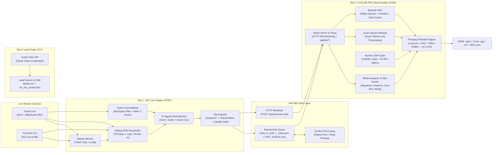
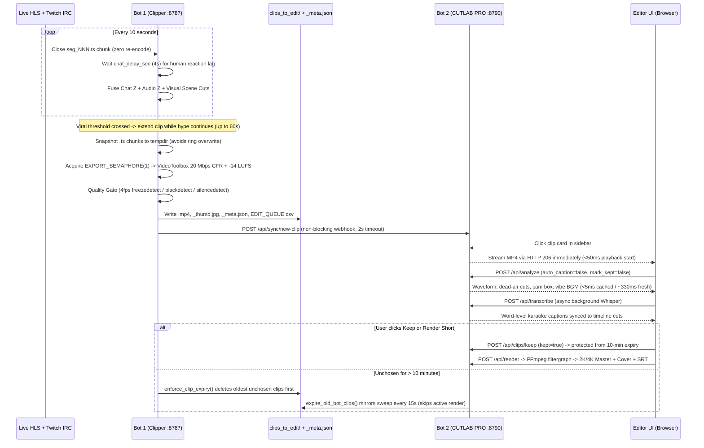

# Real-Time Multi-Stream Viral Clipping & Automated Vertical Video Studio
### Technical Architecture & Engineering Report

> [!NOTE]
> **Project Snapshot:** ~9,090 lines of Python & vanilla JavaScript across 3 cooperating local services/bots, zero paid third-party SaaS APIs, Apple Silicon `h264_videotoolbox` hardware acceleration, local OpenAI Whisper ASR, and 13 passing automated unit & integration tests across 3 test suites.

---

## 1. Executive Summary

Live streamers generate 4–12 hours of continuous 1080p60 video per session, yet short-form growth on YouTube Shorts and TikTok requires finding the best 20–45 second moments within minutes and re-editing them into vertical (`9:16`) format with dynamic framing, word-level captions, voice processing, and music. Doing this manually costs hours of VOD scrubbing per stream.

I engineered an **end-to-end, event-driven multi-bot media pipeline** that automates the entire lifecycle from live stream ingestion to finished `1440×2560` (2K) / `2160×3840` (4K) YouTube Shorts:

1. **Bot 1 — 24/7 Live Stream Clipper (`clipper_bot/`, port `:8787`)**: Monitors multiple Twitch and YouTube Live channels concurrently, records zero-re-encode rolling MPEG-TS ring buffers, detects genuine viral moments by fusing chat anomalies, audio loudness spikes, and visual scene cuts, enforces automated quality gates, and exports constant-frame-rate (CFR) 1080p60 masters.
2. **Bot 2 — CUTLAB PRO Automated Shorts Studio (`shorts_studio/`, port `:8790`)**: Syncs in real time with Bot 1 via webhook + filesystem reconciliation, analyzes audio waveforms and dead air, classifies clip mood to auto-assign synthesized copyright-free music and SFX, generates word-level spoken captions via local OpenAI Whisper, provides a 60fps HTML5 Canvas interactive NLE in the browser, and compiles multi-track FFmpeg filtergraphs with hardware H.264 encoding.
3. **Bot 3 — Streamer Prospecting & Scoring Pipeline (`lead_finder/find_leads.py`)**: Queries the official Twitch Helix API to discover consistent mid-tier creators, filters opt-out bios, scores prospects `0–100` across consistency and channel signals, and maintains an idempotent CRM CSV preserving manual outreach columns.

---

## 2. System Architecture & End-to-End Multi-Bot Workflow

The system uses a **decoupled microservice architecture** with an **embedded single-process fallback**: Bot 1 normally runs independently as a macOS `launchd` background daemon (`:8787`), while Bot 2 (`:8790`) runs as the unified studio UI and reverse-proxies `/api/bot/*` to Bot 1. If Bot 1 is offline when Bot 2 starts, Bot 2 automatically imports `ClipperBotEngine` and runs it in-process so the user always has a single unified workspace.

### Real-Time Inter-Bot Event Sequence

---

## 3. How We Categorize & Score Everything (5-Layer Taxonomy)

A core design principle of this system is **replacing brittle fixed thresholds with per-channel adaptive baselines and structured categorization** at every stage of the pipeline:

### Layer 1: Stream & Category Qualification (`stream_monitor.py`, `bot.py`)
- **Discovery:** Queries Twitch's GraphQL endpoint (sub-second, zero API key) with `yt-dlp --dump-single-json` fallback for YouTube Live and Kick.
- **Topic Categorization:** Evaluates `matches_gta6_filter()` against stream category + title using configurable keywords (`gta 6`, `gta vi`, `vice city`, `leonida`, etc.), with a per-streamer `watch_any_game` override.
- **2-Strike Offline Hysteresis:** Active workers require **2 consecutive offline polls** before detaching if their ring buffer is still healthy, preventing transient 20-second `yt-dlp` timeouts on YouTube from interrupting live recording.

### Layer 2: Chat Noise Filtering & Anomaly Categorization (`chat_watcher.py`)
Raw Twitch chat message-per-second (MPS) is heavily polluted by bots, giveaways, and raids. `ChatSpikeTracker` categorizes every incoming IRC line before scoring:

| Message / Event Class | Rule | Handling |
|---|---|---|
| **Bot Accounts & Spam** | `KNOWN_BOTS` (22 bots like `nightbot`, `streamelements`), usernames ending in `bot`, `!commands`, URLs, `>220` chars | Dropped immediately (`filtered_messages += 1`) |
| **Single-User Spammer** | Per-viewer counter inside 6s window | Hard-capped at **2 effective messages per user** |
| **Copypasta / Giveaway Flood** | Normalized text (`normalize_message` strips invisible Unicode + repeated chars); identical non-reaction message `>= 30%` of window | Rate penalized by `max(0.15, 1.0 - spam_share * 1.5)` |
| **Raid / Mass Gift-Sub Bomb** | IRC `USERNOTICE` with `raid` (18s) or `submysterygift >= 10` (15s) or `>= 12` `subgift` notices in 6s (14s) | Suppresses chat Z-score (`z <= 1.0`) and excludes window from baseline; normal sub trickles on large streams are **not** suppressed |
| **Genuine Audience Reaction** | Regex matching reaction tokens (`clip that`, `lmao`, `no way`, `kekw`, `icant`, `💀`, `😭`, `???`, etc.) | Weighted `1.5×` per unique reacting viewer: `rate = (effective_msgs + 1.5 * reaction_users) / dur` |

Instead of mean/standard deviation (which gets skewed by one huge spike), the channel's baseline uses a **robust Median / MAD Z-score** over the last 36 segment windows:

$$z = \frac{\text{value} - \text{median}}{\max(0.3,\; 0.2 \cdot \text{median},\; 1.4826 \cdot \text{MAD})}$$

Tiny chats (`<4` effective messages or `<3` unique users) are capped at `z <= 0.8` so a quiet 3-person chat cannot trigger false positives.

### Layer 3: Tri-Signal Viral Scoring, Trigger Labels & Quality Gate (`viral_detector.py`, `clip_exporter.py`)
Each 10-second segment is evaluated **4 seconds after closing** (`chat_delay_sec = 4.0`) to account for human reaction + stream latency:

1. **Audio Signal (`analyze_segment_audio`)**: Decodes 8 kHz mono PCM via FFmpeg, computes 0.5s RMS bins in dBFS, and calculates an adaptive median/MAD Z-score using `peak_db + 1.5 * clamp(crest - 1.5, 0, 3)` so sharp screams/laughs outscore flat loud background music. Silent segments (`<= -48 dBFS`) return `audio_z = -1.0` without polluting the baseline.
2. **Visual Signal (`analyze_segment_visual`)**: Only runs when triggered (`audio_z >= 1.0`, `chat_z >= 1.2`, or no active chat) using downscaled `scale=240:-2,scdet=t=11` to count scene cuts/explosions (`0.20 + cuts * 0.22`, capped at `1.0`).
3. **Platform-Adaptive Fusion**:
   - Sub-scores map `z = 0 -> 35`, `z = 2.5 -> 80`, `z >= 3.6 -> 100`.
   - **Twitch (active IRC chat):** $\text{Score} = 0.45 \cdot \text{Chat} + 0.35 \cdot \text{Audio} + 0.20 \cdot \text{Visual}$
   - **YouTube Live (no IRC chat):** $\text{Score} = 0.72 \cdot \text{Audio} + 0.28 \cdot \text{Visual} + (6.0\text{ if } \text{AudioZ} \ge 1.2 \text{ or } \text{Visual} \ge 0.60)$
4. **Trigger Categorization & Clip Extension:** Each triggered clip is tagged with its dominant signals (`chat_spike_4.2z`, `audio_hype_2.6z`, `high_action`). While subsequent segments stay `>= 0.85 * threshold`, the pending capture dynamically appends `+extN` up to `max_clip_sec = 60s` so climaxes are never cut off mid-laugh.
5. **Automated Quality Gate (`check_clip_quality`)**: After VideoToolbox export, one low-CPU `fps=4,scale=120:-2` pass rejects clips that are **≥50% frozen** (Twitch commercial slates / BRB screens), **≥50% black**, or **≥60% silent (`-50 dB`)**, preventing junk clips from ever reaching the editor.

### Layer 4: Creative Vibe Classification, Facecam Framing & Retention Lifecycle (`analyzer.py`, `server.py`)
When a clip enters CUTLAB PRO, `classify_clip_vibe()` inspects Whisper transcript text, audio Z-score, visual score, and trigger metadata to categorize the clip into one of **5 production moods**, automatically pairing it with synthesized copyright-free music and mood-matched SFX:

| Mood Category | Detection Signals | Auto-Assigned BGM (`music_synth.py`) | Peak / Pre / Cut SFX (`sfx_synth.py`) |
|---|---|---|---|
| **`action_hype`** | ≥2 action keywords (`cops`, `shoot`, `crash`, `chase`, `explode`, `high_action`) or (`audio_z >= 2.5` & `vis >= 0.45`) | `phonk_drift.wav` (134 BPM Memphis Phonk) | `impact` / `riser` / `whoosh` |
| **`comedy_fail`** | Comedy keywords (`what the hell`, `bruh`, `stop`, `pause`, `no way`, `chill`) | `comedy_bounce.wav` (116 BPM Pluck Bounce) | `vine_boom` / `record_scratch` / `pop` |
| **`suspense_clutch`** | Suspense keywords (`careful`, `behind`, `hide`, `clutch`, `one shot`, `sneak`) | `tension_dark.wav` (100 BPM Dark Pulse) | `boom` / `riser` / `glitch` |
| **`general_hype` (Win)** | Win keywords (`let's go`, `clutch`, `money`, `won`, `cash`) | `trap_hype.wav` (140 BPM Gaming Trap) | `cash_ding` / `riser` / `whoosh` |
| **`vice_vibe`** | GTA / Vice City / Miami metadata context | `vice_synthwave.wav` (118 BPM 80s Synthwave) | `vine_boom` / `whoosh` / `whoosh` |

- **Streamer Facecam Categorization (`STREAMER_CAM_PRESETS`)**: Maps known streamers to empirically measured normalized `(cam_x, cam_y, cam_w, cam_h)` crop coordinates and automatic horizontal gameplay pan (`pan_x = +0.72` for left-side cams, `-0.68` for right-side cams) so the gameplay panel never shows a duplicate slice of the webcam. Camless streamers (`lirik`) auto-switch from `streamer_top` to `blur_bg`.
- **Clip Lifecycle State Machine:** Every bot clip moves through `Unchosen (10-min FIFO countdown)` → either `Auto-Expired (oldest-first deletion of .mp4/.jpg/_meta.json + EDIT_QUEUE.csv scrub)` OR `Kept (kept: true pinned by user or triggered on Export)` → `Exported Master (2K/4K .mp4 + Cover + .srt + SEO .json)`.

### Layer 5: Prospect Lead Categorization (`lead_finder/find_leads.py`)
Scores Twitch creators `0–100` for done-for-you clipping outreach: sweet-spot viewer band (`50–600` viewers = +35), Affiliate status (+15), multi-day streaming consistency (up to +25 across repeated scans), public business email (+10), existing YouTube/TikTok links (+10), and secondary socials (+5), while excluding opt-out bios (`no business / no DMs`) and `do_not_contact.txt`.

---

## 4. Deep Dive: Media, ASR & DSP Engineering (`shorts_studio/`)

| Subsystem | Implementation Details |
|---|---|
| **Rolling Ring Buffer & Stall Recovery** ([ring_buffer.py](../clipper_bot/ring_buffer.py)) | `ffmpeg -c copy -f segment -segment_time 10 -segment_wrap 18` keeps steady-state capture under ~1% CPU and ~80 MB/streamer. A stall watchdog kills FFmpeg if no segment bytes land within `18s` and restarts with `-segment_start_number` without deleting recent pre-roll segments. |
| **Two-Phase Instant Browser Loading** ([app.js](../shorts_studio/static/app.js), [analyzer.py](../shorts_studio/analyzer.py)) | Clicking a clip switches `<video>` immediately (`<50 ms`, HTTP 206 byte-range), fetches cached/fast waveform + layout analysis (`auto_caption=false`, `1.6 ms` cached / `~330 ms` uncached), and runs Whisper asynchronously via `/api/transcribe` with an `activeLoadSeq` token to cancel stale responses on rapid switching. |
| **Local Word-Level Auto-Captions** ([transcriber.py](../shorts_studio/transcriber.py), [caption_renderer.py](../shorts_studio/caption_renderer.py)) | Runs local Homebrew OpenAI Whisper (`base.en`) on a `highpass=85,dynaudnorm` 16 kHz mono WAV, filters silence hallucinations (`"Thank you for watching"`, etc.), caches results by SHA-1 `(path, size, mtime)`, and remaps per-word timestamps across cut and speed-ramped segments via `map_words_to_timeline()`. Because Homebrew FFmpeg lacks `libfreetype`/`drawtext`, Pillow renders crisp `1080×1920` RGBA karaoke overlay plates composited via FFmpeg `overlay=enable='between(t,s,e)'`. |
| **Vertical Reframing & Sharpening** ([render_engine.py](../shorts_studio/render_engine.py)) | 4 layout modes (`streamer_top`, `split_cam`, `blur_bg`, `full`) using `lanczos+accurate_rnd+full_chroma_int`, `hqdn3d` facecam deblocking before upscaling, and AMD FidelityFX Contrast Adaptive Sharpening (`cas=0.45` on facecam, `cas=0.25` on gameplay). Supports per-segment `atempo` speed ramps (`0.5×–2.5×`), dynamic keyframed zooms (`punch`, `push_in`, `zoom_hold`), `xfade` transitions, and 6 color looks. |
| **Broadcast Audio & Procedural Synth** ([music_synth.py](../shorts_studio/music_synth.py), [sfx_synth.py](../shorts_studio/sfx_synth.py)) | Pure NumPy DSP generates 5 copyright-free 16-second stereo WAV music loops and 10 studio SFX at 48 kHz. The render audio graph runs `highpass=90` → `afftdn` spectral denoise → `3.2 kHz` presence EQ → `3.5:1` compressor → `sidechaincompress` BGM ducking keyed off the voice track → timed SFX `adelay` mix → EBU R128 `loudnorm=I=-14:TP=-1.5:LRA=11`. |
| **Hardware Encoding** ([clip_exporter.py](../clipper_bot/clip_exporter.py), [render_engine.py](../shorts_studio/render_engine.py)) | Uses Apple Silicon `h264_videotoolbox` (20 Mbps 1080p, 30 Mbps 1440p 2K, 46 Mbps 2160p 4K, BT.709 color tags, `+faststart`, 320 kbps AAC) with transparent `libx264` fallback on non-macOS systems. |

---

## 5. Engineering Challenges Solved

| Incident / Bottleneck | Root Cause | Fix & Measured Outcome |
|---|---|---|
| **180s Clip Export Timeouts & Laptop Crashing** | Concurrent CPU `libx264 -crf 14` 1080p60 encodes + 60fps `freezedetect` decode + background auto-rendering across 7 live streams saturated CPU/RAM. | Switched to `h264_videotoolbox` hardware encoding (~25× faster, 2–6s/clip), downsampled quality check to `fps=4 -threads 2` (~15× lighter), capped exports via `EXPORT_SEMAPHORE(1)`, added `-threads 4` and `nice -n 10` launcher. |
| **YouTube Live Ring Buffer Freezing at 35s** | YouTube's `playlist_type/DVR` HLS manifest stalled FFmpeg after ~3 segments without exiting (`poll() is None`), while `launchd` `SIGKILL` restarts left orphaned child `ffmpeg` processes clobbering the same `.ts` directory. | Added `18s` mtime stall watchdog + `-rw_timeout 12000000`, persisted recent pre-roll segments using `-segment_start_number`, and added targeted `pkill` cleanup on buffer start. |
| **Stuck `SUPPRESSED(subs/raid)` on 50k+ Streams** | Original rule suppressed chat whenever `>= 3` single sub notices arrived in 12s — which happens continuously on 50k-viewer channels. | Scoped suppression strictly to `raid`, `submysterygift >= 10`, or `>= 12` `subgift` notices in 6s. |
| **30s UI Freeze & Accidental `Kept` State on Click** | Clicking a clip card passed `mark_kept=true` and blocked `<video>` updates behind synchronous Whisper transcription while 7s polling replaced DOM nodes mid-click. | Separated instant preview (`mark_kept=false`, `<50 ms` `<video>` switch, `1.6 ms` cached analysis) from async background Whisper (`/api/transcribe`), switched sidebar to delegated events + in-place DOM updates. |
| **Double-Webcam Sliver in Vertical Framing** | Center-cropped 16:9 gameplay included the left edge of the streamer's overlay webcam right below the top facecam panel. | Measured per-streamer facecam coordinates and applied automatic opposite-side `pan_x` framing (`+0.72` / `-0.68`) plus an interactive drag-to-crop facecam picker. |

---

## 6. Verification & Automated Test Coverage

All 3 subsystems ship with self-contained `unittest` suites (**13/13 tests passing**):
- [test_clipper_bot.py](../clipper_bot/test_clipper_bot.py) (`5 tests`): Chat spam/raid filtering vs. genuine reactions, GTA 6 keyword filter, tri-signal detector + exporter + quality gate + disk quota, 10-minute oldest-first expiry + Keep protection, HTTP API & path-traversal security.
- [test_editor.py](../shorts_studio/test_editor.py) (`4 tests`): Procedural WAV BGM & SFX synthesizers, Pillow RGBA karaoke caption plates + cover thumbnail + `.srt`, vibe classifier + word-level timeline remapping + anti-spam check, full end-to-end 1440×2560 hardware render + HTTP 206 streaming + sync webhook.
- [test_find_leads.py](../lead_finder/test_find_leads.py) (`4 tests`): Public bio contact extraction, opt-out bio filtering, lead scoring invariants, CSV merge preserving manual columns.
